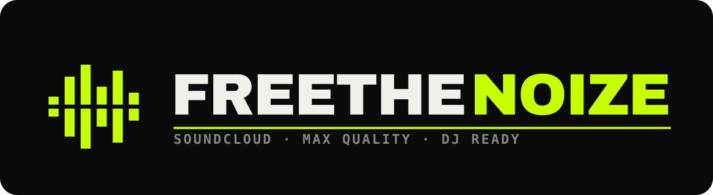

  

  <b>La música que pinchas, a la mejor calidad que existe. Libre, sin dueño y hecho por la comunidad.</b> 
  Download SoundCloud at the best quality available, check its real quality and get it ready for the booth. Free software, community-run.

  
  
  

---

### ✶ Qué es

**[FreeTheNoize](https://github.com/FreeTheNoize/FreeTheNoize)** descarga temas, playlists y perfiles de SoundCloud
siempre desde **la mejor fuente disponible** (el original del artista, AAC 256 o MP3), **sin recodificar**, y te dice
**la verdad sobre esa calidad**: espectrograma, corte de frecuencias para cazar falsos lossless, LUFS y true peak.
Le pone **BPM, tonalidad Camelot** y metadatos completos para Rekordbox, Traktor y Serato.

Va como **app de escritorio** (macOS, Windows, Linux) o como **servicio web** en Docker para tu servidor o NAS.

| | |
|---|---|
| 💿 **Escritorio** | [Descargar la última versión](https://github.com/FreeTheNoize/FreeTheNoize/releases/latest) |
| 🐳 **Servidor** | `docker run -d -p 8765:8765 -e FTN_PASSWORD=… ghcr.io/freethenoize/freethenoize` |
| 📖 **Documentación** | [README del proyecto](https://github.com/FreeTheNoize/FreeTheNoize#readme) |

### ✶ Por qué existe

Porque la escena se construye con música que circula, y quien pincha merece saber qué está sonando de verdad.
FreeTheNoize no tiene anuncios, no pide cuentas y no rastrea a nadie. Y respeta a los artistas: es para uso personal
y no sirve para saltarse lo que cada artista decide sobre su música. **Apoya a quien la hace.**

### ✶ Sin dueño

FreeTheNoize es **horizontal**. No hay jefe: hay *maintainers* y *contributors* que revisan el trabajo de los demás
y deciden juntos quién entra.

- Todo cambio entra por **pull request** y necesita **la aprobación de otra persona**. Nadie aprueba lo suyo, tampoco quien fundó el proyecto.
- Las nuevas personas colaboradoras **las aceptan quienes ya colaboran**, en abierto.
- Las releases las propone un bot y **se revisan antes de publicarse**; cada binario e imagen lleva atestación de procedencia.

Las reglas completas están en [GOVERNANCE.md](https://github.com/FreeTheNoize/FreeTheNoize/blob/develop/GOVERNANCE.md).

### ✶ Súmate

No hace falta programar para aportar:

- 🎧 **Pruébalo** y [cuéntanos qué falla](https://github.com/FreeTheNoize/FreeTheNoize/issues/new/choose), sobre todo enlaces que no bajan bien.
- 💬 **Propón ideas** en [Discussions](https://github.com/FreeTheNoize/FreeTheNoize/discussions).
- 👀 **Revisa PR** de otras personas: probar y comentar es tan valioso como escribir código.
- 🛠️ **Programa**: empieza por los issues [`good first issue`](https://github.com/FreeTheNoize/FreeTheNoize/labels/good%20first%20issue) y lee la [guía para contribuir](https://github.com/FreeTheNoize/FreeTheNoize/blob/develop/CONTRIBUTING.md).
- 🔒 **¿Un fallo de seguridad?** Repórtalo [en privado](https://github.com/FreeTheNoize/FreeTheNoize/security/advisories/new).

Todo con respeto: aplica el [código de conducta](https://github.com/FreeTheNoize/FreeTheNoize/blob/develop/CODE_OF_CONDUCT.md).

<b>FREE THE NOIZE ✶</b>

